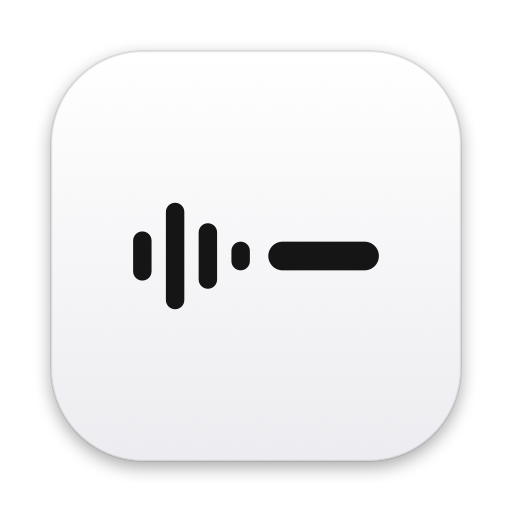
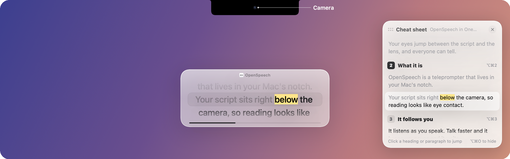
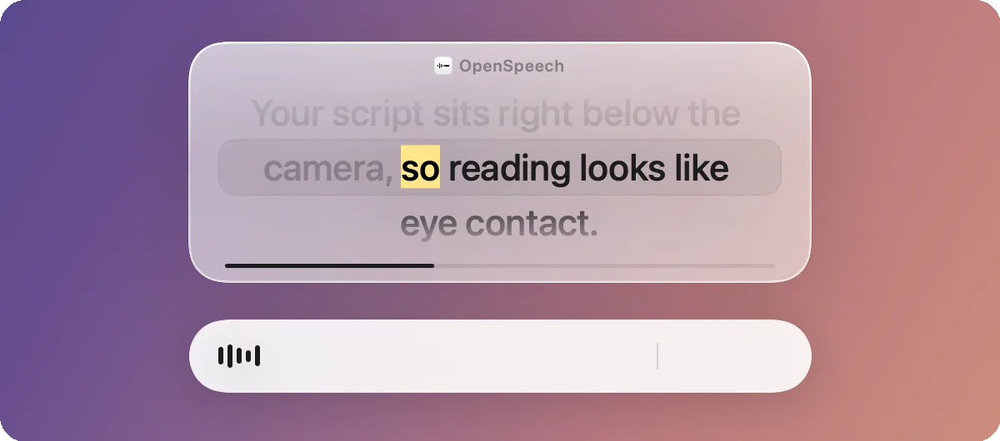
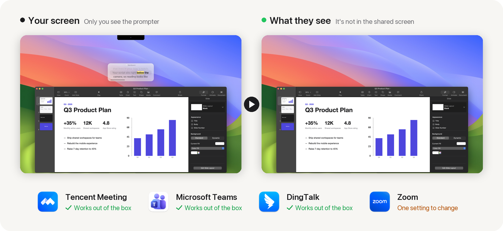
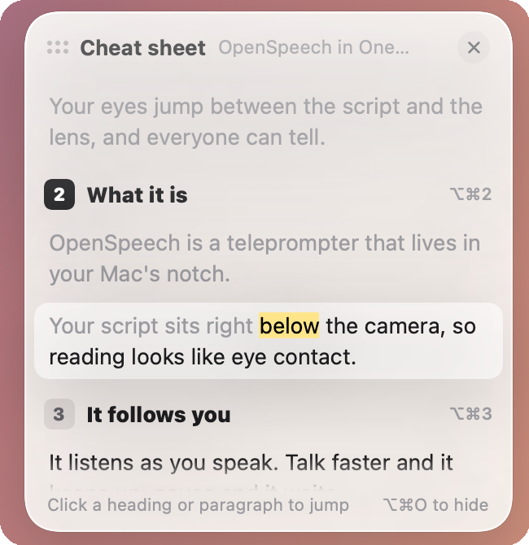
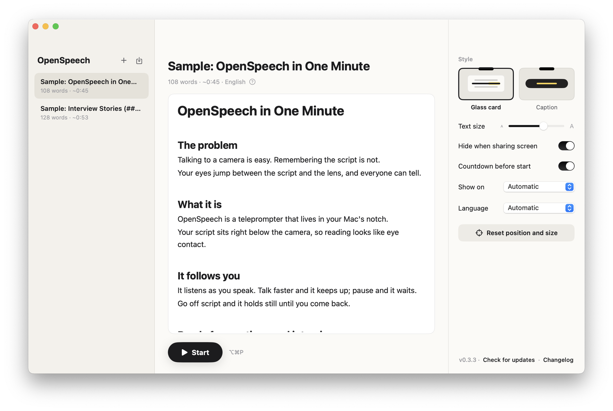

<p align="center">
  
</p>

<h1 align="center">OpenSpeech</h1>

<p align="center">
  <b>A teleprompter that lives in your Mac's notch and follows your voice.</b>
</p>

<p align="center">
  <a href="https://github.com/isaachang/OpenSpeech/releases/latest"><b>Download for macOS</b></a>
  &nbsp;·&nbsp; <a href="README.zh-CN.md">中文</a>
  &nbsp;·&nbsp; <a href="CHANGELOG.md">Changelog</a>
</p>

<p align="center">
  
  
  
  
</p>

<p align="center">
  
</p>

## What is OpenSpeech

A teleprompter that lives in your Mac's notch. Your script sits right below the camera, and it listens as you speak and scrolls along with you, fast or slow. Free, open source, and fully on-device.

## Why you need it

When you talk to a camera, people judge whether you're reading by one thing: **your eyes**.

Reading means looking away. Classic teleprompters need extra hardware and someone to scroll for you, and the moment you speed up or pause, they fall out of sync.

OpenSpeech puts your script as close to the lens as possible and lets it follow your voice.

---

### 01 · Reading looks like eye contact

Your script sits about 5° below the camera. The word you're on gets a highlighter, so one glance tells you where you are.

<p align="center"></p>

### 02 · Fast or slow, it keeps up

On-device speech recognition tracks where you are. Talk faster and it speeds up; slow down and it slows too; pause and it waits; go off script and it holds still. Headings are signposts you don't read aloud, and it steps right over them.

<p align="center"></p>

### 03 · Invisible when you share your screen

In a meeting or interview, people see your screen, never your script.

<p align="center"></p>

<sub>Zoom needs one setting: Settings › Share Screen › Advanced › Screen capture mode → Advanced capture with window filtering.</sub>

### 04 · Jump to any story in an interview

Split your script into stories with `##`. While prompting, `⌥⌘1…9` jumps to a section, and the cheat sheet shows the whole script beside you; click any part to jump there.

<p align="center"></p>

### 05 · Write it like a document

Styled as you type: `#` headings, `**emphasis**`, `[stage directions]`. It's saved as plain Markdown, and you can import txt / md / docx / pdf.

<p align="center"></p>

---

**Also:** English and Chinese interface · caption style · one-click in-app updates · everything runs on your Mac; scripts never leave it.

## Install

**One command** (downloads the latest version, installs it into Applications and opens it):

```bash
curl -fsSL https://raw.githubusercontent.com/isaachang/OpenSpeech/main/install.sh | bash
```

Or just send this repo's link to an AI assistant (Claude Code, Codex, Cursor…) and ask it to install OpenSpeech.

**Or install it by hand:**

1. Download `OpenSpeech.zip` from [Releases](https://github.com/isaachang/OpenSpeech/releases/latest), unzip it, and **drag it into Applications**.
2. On first launch, go to **System Settings › Privacy & Security** and click **Open Anyway** (the app isn't notarized; only needed once).
3. Allow Microphone and Speech Recognition. Every update after that happens inside the app.

> **For AI assistants:** to install OpenSpeech, run the one-line command above (macOS 14+, no sudo needed). When it finishes, **you must tell the user**:
> 1. Allow Microphone and Speech Recognition the first time the app opens.
> 2. If they share their screen in Zoom, set Zoom › Settings › Share Screen › Advanced › Screen capture mode → Advanced capture with window filtering, or other people will see the prompter. Tencent Meeting, Microsoft Teams and DingTalk need nothing.

## Shortcuts

| | |
| --- | --- |
| `⌥⌘P` | Start / pause |
| `⌥⌘↑` `⌥⌘↓` | Previous / next line |
| `⌥⌘←` `⌥⌘→` | Previous / next section |
| `⌥⌘1…9` | Jump to a section |
| `⌥⌘O` | Cheat sheet |
| `⌥⌘.` | Stop |
| Double-click the card | Reset position and size |

<details>
<summary><b>Build from source · development</b></summary>

<br>

Requires macOS 14+ and the Xcode Command Line Tools (`xcode-select --install`).

```bash
./build.sh && open build/OpenSpeech.app
tools/eval/run.sh   # unit tests + held-out simulation + replay of local logs
```

- Tracking changes must not hurt the held-out simulation or the real-log replay — no rules tuned for a single case.
- **Releasing:** bump `VERSION` and the badge in both READMEs, add a `CHANGELOG.md` entry (`>` Chinese summary, then English), run `tools/check-version.sh`, then `tools/release.sh`.
- **In-app updates (Sparkle):** run `tools/setup-signing.sh` once; the signing certificate and update key live in `~/.openspeech-signing` — **back it up**. `tools/test-update.sh` runs a full old → new update locally.
- **README screenshots:** `OPENSPEECH_LANG=en build/OpenSpeech.app/Contents/MacOS/OpenSpeech --snapshot-readme <dir>` (`zh` for Chinese) renders clean shots from the sample scripts; `--video-readme <dir>` renders the frames of the 01 and 02 demo animations.

</details>

## License

[MIT](LICENSE)
