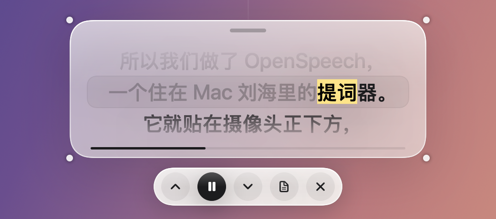
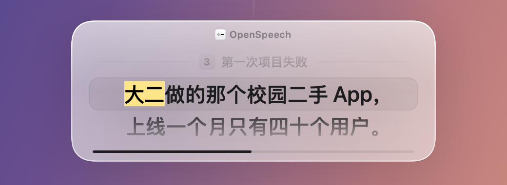
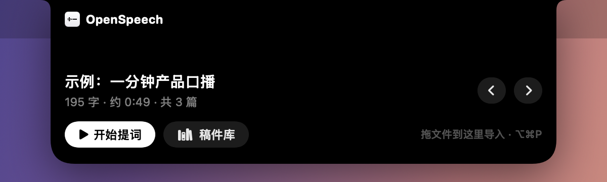
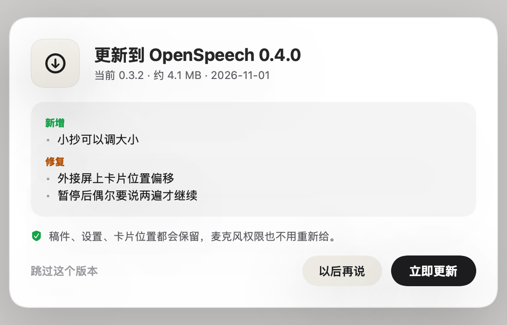
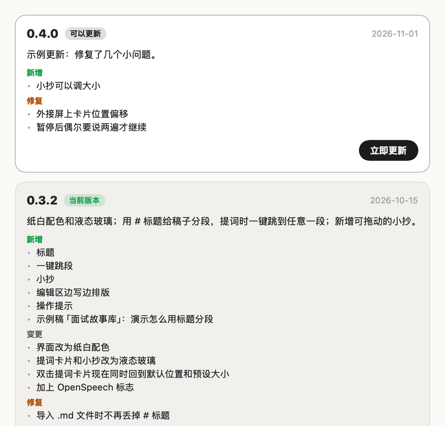

<p align="center">
  
</p>

<h1 align="center">OpenSpeech</h1>

<p align="center">
  <b>住在 MacBook 刘海里、跟着你的声音走的提词器。</b><br>
  稿子就在摄像头正下方：你看稿的时候，眼神几乎就是在看镜头。
</p>

<p align="center">
  <a href="https://github.com/isaachang/OpenSpeech/releases/latest"><b>⬇︎ 下载最新版</b></a>
  &nbsp;·&nbsp; <a href="README.md">English</a>
  &nbsp;·&nbsp; <a href="CHANGELOG.md">版本日志</a>
</p>

<p align="center">
  
  
  
  
</p>

<p align="center">
  
</p>

开会、面试、上台讲 presentation、录口播：只要需要**看着镜头念稿**，OpenSpeech 就是为这些场合做的。

> **当前状态：早期版本（v0.3.2）。** 核心的语音跟随已经稳定可用，界面和功能还在快速迭代。

<table>
  <tr>
    <td width="33%" valign="top"><b>🎙 跟着你的声音走</b><br>本机语音识别实时判断你讲到哪。中文、英文、中英混排都可以。</td>
    <td width="33%" valign="top"><b>🎯 看稿 = 看镜头</b><br>默认在摄像头正下方约 5°。可以随手拖动、调大小，双击回到默认。</td>
    <td width="33%" valign="top"><b>🧭 不会乱跳</b><br>你脱稿、自由发挥时它停住等你；只有真的一路念过来，它才往前走。</td>
  </tr>
  <tr>
    <td valign="top"><b>📑 标题分段 + 一键跳</b><br>用 <code>##</code> 把稿子分成一段段经历，提词时按 <code>⌥⌘1…9</code> 直接跳过去。</td>
    <td valign="top"><b>🗒 小抄</b><br>屏幕角落显示整篇稿子，讲到哪滚到哪，点一下就跳到那一段。</td>
    <td valign="top"><b>🙈 共享屏幕时看不见</b><br>腾讯会议、Teams、钉钉、Zoom 里，对方只看到你的屏幕，看不到你的稿子。</td>
  </tr>
</table>

---

## 提词卡片：液态玻璃 + 荧光笔

<p align="center"></p>

- **正在读的字用荧光笔黄标出来**，读过的字变浅，还没读的是黑字。镜头前扫一眼就知道讲到哪了。
- **液态玻璃**：卡片能隐约透出后面的内容，字依然清楚。
- **随手调**：拖动移动（靠近镜头中线会自动吸附，触控板轻震一下）；拖四个角调整每行字数和行数；**双击回到默认位置和大小**。每块屏幕各记各的位置。
- 鼠标放上去，下方出现控制条：上一行 · 暂停 · 下一行 · 小抄 · 结束。

还有一种更紧凑的**字幕胶囊**样式：只显示这一句和下一句，字更大。

<p align="center"></p>

## 用标题分段，一键跳到任何一段

面试时准备了很多段经历？用 Markdown 标题把稿子分开：

```markdown
# 产品经理面试

## 自我介绍
面试官好，我叫林然……

## 团队冲突：跨部门排期
那次我们和设计组在上线时间上卡住了……

## 第一次项目失败
大二做的那个校园二手 App……
```

<p align="center"></p>

- **标题只是路牌，不用念**：在卡片上显示成灰色小字，讲完上一段直接开口讲下一段，提词器会自动跨过标题。
- **⌥⌘1 … ⌥⌘9**：跳到第几个小标题，刘海里会提示「→ 3 第一次项目失败」。这组快捷键只在提词时占用，平时还给别的 App。

## 小抄：整篇稿子就在旁边

<p align="center"></p>

- 提词时在屏幕角落显示**整篇稿子**：标题带编号和快捷键，正在讲的这段高亮，跟着你自动滚动。
- **点标题或段落就跳过去**，提词卡片和语音跟随都从那里接着走。
- **可以拖到任何地方**（按住顶部的六个小点），双击顶部回到右上角。快捷键 `⌥⌘O` 打开 / 收起。
- 和提词卡片一样，**共享屏幕时对方看不到**。

## 稿件库和编辑区

<p align="center"></p>

- **边写边排版**，用法和 Notion 一样：输入 `# ` 变大标题，`## ` 变中标题，`### ` 变小标题。`**重点**` 显示成粗体，`【导演提示】` 显示成橙色。
- `#` 和 `**` 这些标记平时藏起来，光标所在的那一行才淡淡显示。存下来的还是标准 Markdown，复制到哪都不丢格式。
- `⌘⌥1` / `⌘⌥2` / `⌘⌥3` 设成大 / 中 / 小标题，`⌘⌥0` 变回正文。
- 支持导入 txt · md · docx · doc · rtf · pdf · html，也可以把文件直接拖到刘海上。

鼠标移到刘海上，会展开一个小面板，不打开主窗口也能开始：

<p align="center"></p>

## App 里一键更新

<table>
  <tr>
    <td width="55%" valign="top"></td>
    <td width="45%" valign="top"></td>
  </tr>
</table>

- 有新版本时，主窗口顶部会出现提示，**点「立即更新」**就会自动下载、校验、安装、重新打开。稿件和设置都保留，麦克风权限也不用重新给。
- **正在提词时不打扰**，讲完才提示。
- 右下角「**版本日志**」用卡片列出每个版本改了什么。

---

## 下载安装

1. 打开 [Releases 页面](https://github.com/isaachang/OpenSpeech/releases/latest)，下载 `OpenSpeech-x.y.z.zip`，双击解压。
2. 把 `OpenSpeech.app` **拖进「应用程序」文件夹**。不要直接在「下载」里打开，否则以后没法在 App 里更新。
3. 第一次打开时，macOS 会提示"无法验证开发者"（我们没有付费的苹果开发者账号）。点「完成」，然后打开 **系统设置 › 隐私与安全性**，拉到最下面点 **「仍要打开」**。macOS 14 也可以直接在「应用程序」里右键 OpenSpeech › 打开。只有第一次需要这样做。
4. 允许 **麦克风** 和 **语音识别** 权限。

之后的新版本都在 App 里一键更新。

## 稿子怎么写

| 写法 | 效果 | 要念吗 |
| --- | --- | --- |
| `# 大标题` `## 中标题` `### 小标题` | 分段；提词卡片上显示成灰色路牌 | 不用念 |
| `**重点**` | 加粗，提醒自己重读 | 要念 |
| `【停顿一拍】` / `[Pause]` | 导演提示，橙色 | 念不念都行 |

## 快捷键

| 键 | 作用 |
| --- | --- |
| `⌥⌘P` | 开始 / 暂停 / 继续 |
| `⌥⌘↑` `⌥⌘↓` | 上一行 / 下一行（也可以在卡片上双指滑动） |
| `⌥⌘1` … `⌥⌘9` | 提词时跳到第几段 |
| `⌥⌘O` | 打开 / 收起小抄 |
| `⌥⌘←` `⌥⌘→` | 匀速模式下减速 / 加速 |
| `⌥⌘.` | 结束 |
| `⌘⌥1` `⌘⌥2` `⌘⌥3` `⌘⌥0` | 编辑区：大 / 中 / 小标题 / 正文 |
| 双击提词卡片 | 回到默认位置和大小 |

## 共享屏幕

开会共享屏幕时，提词卡片和小抄对其他参会人都是看不见的。

| 会议软件 | 共享时是否隐藏 |
| --- | --- |
| 腾讯会议 | ✅ 直接可用（已实测） |
| Microsoft Teams | ✅ 直接可用（已实测） |
| 钉钉会议 | ✅ 直接可用（已实测） |
| Zoom | ⚙️ 需要先改一个设置（见下方） |

**Zoom 设置方法（设置一次，之后一直生效）：** Zoom → **设置** → **共享屏幕** → 最下面 **高级** → **屏幕捕获模式**，改成 **"高级捕获（带窗口过滤）"**（Advanced capture with window filtering）。不改的话，Zoom 默认的捕获模式会把屏幕上所有东西都录进去，提词器也会被别人看到。

## 隐私

所有处理都在你的 Mac 上完成，稿子不会上传到任何地方。跟随日志（用于调优）只存在 `~/Library/Application Support/OpenSpeech/logs/`，可以在「文件 › 开发者选项」里关掉。

---

## 从源码编译

需要 macOS 14 及以上和 Xcode 命令行工具（`xcode-select --install`）。

```bash
./build.sh
open build/OpenSpeech.app
```

## 开发

```bash
tools/eval/run.sh   # 单元测试 + 新稿件模拟 + 本机真实日志回放
```

改动跟随算法时，必须在"没见过的新稿件模拟"和"真实日志回放"两份数据上都没有变差，不为单个案例加规则。

**发布新版本：** 改 `VERSION`、两个 README 里的版本号，在 `CHANGELOG.md` 里加一条记录（标题下面用 `>` 写一句给用户看的总结，App 里会显示），然后运行 `tools/check-version.sh` 检查。

**App 内更新（Sparkle）：** 第一次先运行 `tools/setup-signing.sh`，生成本机签名证书和更新签名私钥，放在 `~/.openspeech-signing`，**一定要备份这个文件夹**。`tools/test-update.sh` 在本机把"旧版本 → 新版本"完整跑一遍；`tools/release.sh` 编译通用版本、签名、生成 `appcast.xml` 并发布到 GitHub Releases。

**README 截图：** `build/OpenSpeech.app/Contents/MacOS/OpenSpeech --snapshot-readme <目录>` 用示例稿生成干净的截图（统一的桌面背景，不带屏幕上的其他内容）。

`docs/` 里是开发过程中的调研记录（当时产品还叫 NotchCue）。

## 许可证

[MIT](LICENSE)
