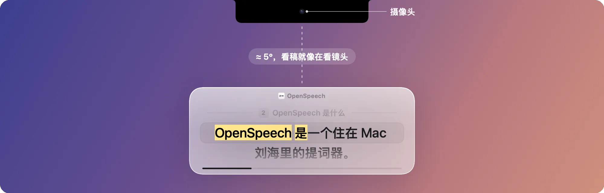
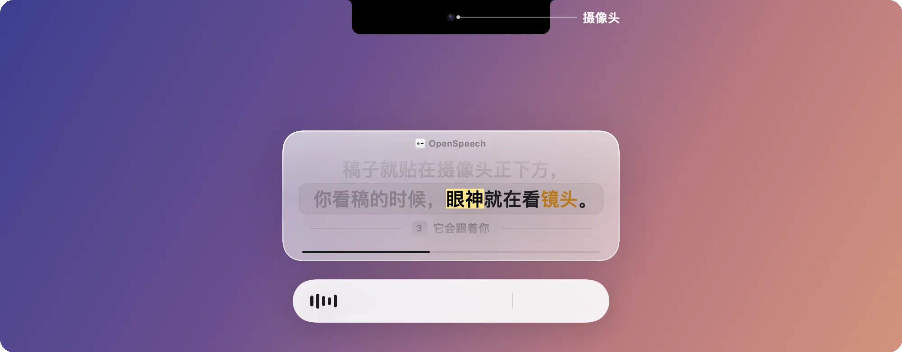
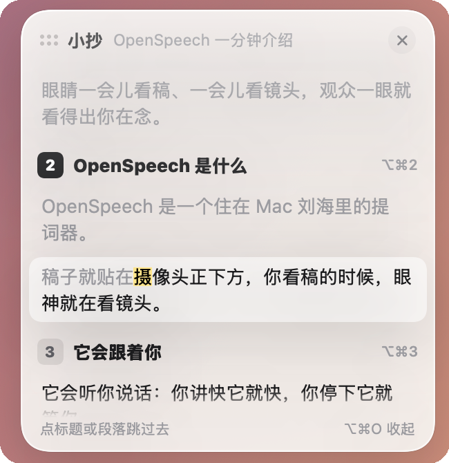
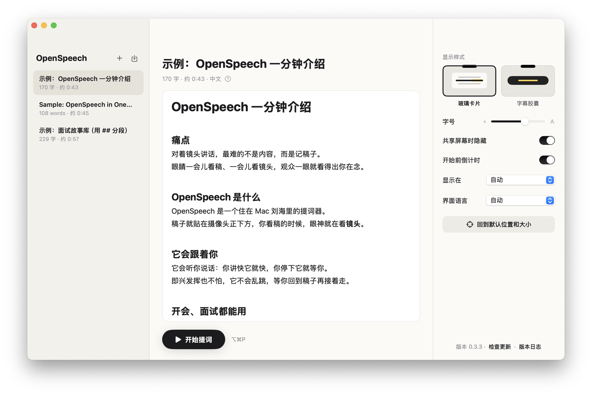

<p align="center">
  
</p>

<h1 align="center">OpenSpeech</h1>

<p align="center">
  <b>住在 Mac 刘海里、跟着你声音走的提词器。</b>
</p>

<p align="center">
  <a href="https://github.com/isaachang/OpenSpeech/releases/latest"><b>下载 macOS 版</b></a>
  &nbsp;·&nbsp; <a href="README.md">English</a>
  &nbsp;·&nbsp; <a href="CHANGELOG.md">版本日志</a>
</p>

<p align="center">
  
  
  
  
</p>

<p align="center">
  
</p>

## OpenSpeech 是什么

一个住在 Mac 刘海里的提词器。稿子就贴在摄像头正下方，它听你说话，自动跟着你往下走，讲快讲慢都跟得上。免费、开源，全部在本机运行。

## 为什么你需要它

对着镜头讲话，别人判断你是不是在念稿，只看一件事：**眼神**。

看稿就得移开视线；传统提词器要买硬件、要有人帮你滚屏，你一讲快或一停顿，它就对不上了。

OpenSpeech 把稿子放到离镜头最近的地方，让它自己跟着你的声音走。

---

### 01 · 看稿，就是在看镜头

稿子贴在摄像头正下方约 5°。正在读的字用荧光笔标出来，扫一眼就知道讲到哪了。

<p align="center"></p>

### 02 · 讲快讲慢，它都跟得上

本机语音识别听你讲到哪：讲快它就快，讲慢它就慢，停下它就等你，脱稿也不会乱跳。标题只是路牌，不用念，会自动跨过去。

<p align="center"></p>

### 03 · 共享屏幕时，对方看不到

开会、面试共享屏幕，别人只看到你的画面，看不到你的稿子。

<p align="center"></p>

<sub>Zoom 需要改一个设置：设置 › 共享屏幕 › 高级 › 屏幕捕获模式 → 「高级捕获（带窗口过滤）」。</sub>

### 04 · 面试问到哪，一键跳到哪

用 `##` 把稿子分成一段段经历。提词时按 `⌥⌘1…9` 直接跳段；「小抄」在旁边显示整篇稿子，点哪段就跳到哪段。

<p align="center"></p>

### 05 · 像写文档一样写稿

边写边排版：`#` 大标题、`##` 中标题、`**重点**`、`【导演提示】`。存下来是标准 Markdown，也能直接导入 txt / md / docx / pdf。

<p align="center"></p>

---

**另外：** 中英文界面 · 字幕胶囊样式 · App 内一键更新 · 所有处理都在本机完成，稿子不上传。

## 下载安装

**一行命令装好**（自动下载最新版、装进「应用程序」并打开）：

```bash
curl -fsSL https://raw.githubusercontent.com/isaachang/OpenSpeech/main/install.sh | bash
```

也可以直接把这个仓库的链接发给 AI 助手（Claude Code、Codex、Cursor 等），说一句"帮我装一下"。

**或者手动安装：**

1. 从 [Releases](https://github.com/isaachang/OpenSpeech/releases/latest) 下载 `OpenSpeech.zip`，解压后**拖进「应用程序」**。
2. 第一次打开时，去 **系统设置 › 隐私与安全性** 点 **「仍要打开」**（App 没有付费签名，只需要这一次）。
3. 允许麦克风和语音识别。之后的新版本在 App 里一键更新。

> **给 AI 助手：** 用户让你安装 OpenSpeech 时，运行上面那一行命令即可（macOS 14+，不需要 sudo）。装完后**一定要告诉用户**：
> 1. 第一次打开时允许「麦克风」和「语音识别」。
> 2. 如果用 Zoom 共享屏幕，要在 Zoom › 设置 › 共享屏幕 › 高级 › 屏幕捕获模式 选「高级捕获（带窗口过滤）」，否则对方会看到提词器。腾讯会议、Microsoft Teams、钉钉不用改。

## 快捷键

| | |
| --- | --- |
| `⌥⌘P` | 开始 / 暂停 |
| `⌥⌘↑` `⌥⌘↓` | 上一行 / 下一行 |
| `⌥⌘1…9` | 跳到第几段 |
| `⌥⌘O` | 小抄 |
| `⌥⌘.` | 结束 |
| 双击提词卡片 | 回到默认位置和大小 |

<details>
<summary><b>从源码编译 · 开发</b></summary>

<br>

需要 macOS 14+ 和 Xcode 命令行工具（`xcode-select --install`）。

```bash
./build.sh && open build/OpenSpeech.app
tools/eval/run.sh   # 单元测试 + 新稿件模拟 + 本机日志回放
```

- 改跟随算法时，"没见过的新稿件模拟"和"真实日志回放"都不能变差，不为单个案例加规则。
- **发版：** 改 `VERSION`、两个 README 的版本号，在 `CHANGELOG.md` 加一条（`>` 第一行中文、第二行英文总结），运行 `tools/check-version.sh`，然后 `tools/release.sh`。
- **App 内更新（Sparkle）：** 第一次先运行 `tools/setup-signing.sh`，签名证书和更新私钥在 `~/.openspeech-signing`，**一定要备份**。`tools/test-update.sh` 在本机把"旧版本 → 新版本"跑一遍。
- **README 截图：** `OPENSPEECH_LANG=zh build/OpenSpeech.app/Contents/MacOS/OpenSpeech --snapshot-readme <目录>`（`en` 出英文版），用示例稿生成干净的截图；`--video-readme <目录>` 逐帧渲染 01、02 的演示动画。

</details>

## 许可证

[MIT](LICENSE)
